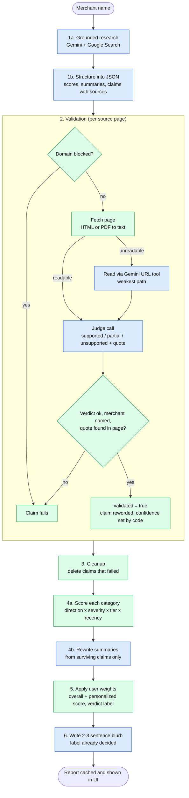

# How the research pipeline works

Owner: Person B (Research engine). Code: `backend/app/services/` (`ethics.py`, `validation.py`, `scoring.py`, `verdict.py`, `gemini.py`). Design decisions and measured results: `docs/VALIDATION_PLAN.md`.

This page has two parts: a short overview, then the step-by-step detail. Both mark which parts are **AI** (a Gemini call) and which are **code** (plain Python, same answer every time).

---

# Part 1: Overview

Gemini researches a merchant and lists claims about it. Because an AI can state wrong things confidently, a second pass checks each claim against the web page it cites and throws out the ones that fail. Only what survives is scored.

```text
1. Research      AI     Gemini searches the web, writes claims, each pointing at a source
2. Validation    AI+code  fetch each source page, a second Gemini call reads it, code checks the result
3. Cleanup       code   delete claims that failed
4. Score         code+AI  code scores each category from surviving claims; Gemini rewrites the summaries
5. Your values   code   combine category scores with your weights, decide aligns / mixed / against
6. Blurb         AI     Gemini writes a 2-3 sentence explanation of a verdict that code already decided
```

## Flowchart

Blue boxes are AI (a Gemini call), green boxes are code.



## Example

Gemini's research includes two claims about Starbucks:

- **A:** "Starbucks recorded an 8% increase in greenhouse gas emissions compared to 2019." Source: a Packaging Dive article.
- **B:** "The Starbucks Rewards app collects precise geolocation." Source: a 2013 Legal 500 article about mobile payments.

Both sound equally confident at this point. Validation opens each source page:

- **A:** the page says emissions rose 8% against a fiscal 2019 baseline. The judge quotes that sentence, code finds the quote on the page, and the claim is kept.
- **B:** the 2013 article never mentions Starbucks or geolocation. The judge says unsupported and the claim is deleted. The user never sees it.

The environment score is then recomputed from the claims that survived, combined with the user's priorities, and turned into a verdict.

## Who decides what

| Decision | Made by |
| --- | --- |
| What claims to propose, and which source supports each | AI (research) |
| Whether a source page supports a claim | **AI** (the judge) |
| Whether the judge's quote really appears on the page, and the page names the merchant | Code |
| Whether a source domain is blocked, and how trustworthy it looks | Code |
| The final `validated` flag | Code, using the judge's verdict plus its own checks |
| Whether a claim is good or bad for the company, and how serious | AI (the judge) |
| The score of each category | Code, from those labels plus source tier and event year |
| The category summary text | AI (from surviving claims only) |
| The aligns / mixed / against label | Code |
| The wording of the explanation paragraph | AI |

## The honest limit

The checker is also Gemini. The judge works differently from the researcher (no search tool, one page at a time, told to ignore its own knowledge), which makes it a real improvement over trusting the researcher, but it is not independent verification. Code only independently confirms things on pages we could fetch ourselves, and there it proves the quoted sentence exists, not that it supports the claim. On pages that block our fetcher, Gemini's verdict alone decides. Measured on 22 hand-labeled claims: 93% precision, 88% recall.

---

# Part 2: Step by step

The entry point is `ethics.get_report()` in `ethics.py`. In live mode (`USE_MOCK_DATA=false` and a Gemini key) a cold merchant makes about 21-30 Gemini calls and takes about 3 minutes.

## Step 1: Research (AI, 2 calls)

Code: `research_with_gemini()` in `ethics.py`.

**Call 1, grounded research (AI).** Gemini searches Google (the Google Search grounding tool) for the merchant across five areas: labor, environment, animal welfare, community, privacy. The prompt asks for at least 5 concrete facts per area, prefers government, court, regulator and established news sources, and forbids forums, social media, Wikipedia and review sites. The output is free text, plus Google's metadata saying which sentences came from which web pages.

**Call 2, structuring (AI).** A second call (no search) converts that text to JSON: per category a 0-100 score, a 2-sentence summary, and 4-6 claims. Each claim has `text`, a `source` number chosen from the sources Google reported for that statement, and a `confidence`. The source choice and confidence are Gemini's opinion and are not trusted.

**Then code takes over:**
- Source numbers are mapped to URLs from Google's metadata. URLs never come from text the model wrote, so it cannot invent a link.
- Google's redirect links are resolved to the real page with a plain HTTP request.
- The result is cached per merchant in `_research_cache`.

Takes about 80-130 seconds.

## Step 2: Validation (AI + code)

Code: `validate_claims()` in `validation.py`. Claims are grouped by source URL (one pass per page, so two claims citing the same page share one judge call). Pages are processed in parallel.

### 2a. Fetch the page (code)

We download the page ourselves: HTML is stripped to text, PDFs are read with `pypdf`. Safeguards: 10 second timeout, 3 MB cap, up to 5 redirects with every hop checked, and private or internal addresses are refused so a source URL cannot make the server hit internal services. A page with under 500 characters of text is treated as unreadable (bot walls and JavaScript shells look like this).

### 2b. Check the domain (code)

- **Blocked:** reddit, X/Twitter, Facebook, Instagram, TikTok, Quora, Medium, YouTube, Glassdoor, Indeed, Pinterest, LinkedIn, Threads, Wikipedia. Claims from these fail.
- **Tier 1:** government and courts (`.gov`, `.europa.eu`, `uscourts.gov`, and similar).
- **Tier 2:** established news, trade press and ratings groups (about 90 domains).
- **Tier 3:** the company's own site (the domain contains the merchant's name or an alias).
- **Tier 4:** everything else: advocacy groups, law firms, blogs, unknown sites.

The tier controls how the claim is worded (step 2d), its confidence number, and how much it counts in the category score (step 4).

### 2c. The judge (AI, one call per source page)

A Gemini call is given the merchant, the page, and the claims that cite it. It sees only the passages of the page most relevant to the claims (about 9,000 characters, chosen by keyword overlap by code), or, if we could not fetch the page, it reads the URL itself through Gemini's URL context tool. It is told to judge from the page only, not from its own knowledge. For each claim it returns:

- **verdict:** `supported` (the page states it; rewording alone does not make it partial), `partial` (a specific number, date, scope or actor had to be corrected or removed), or `unsupported`.
- **quote:** one sentence copied exactly from the page.
- **rewritten text:** the claim limited to what the page supports. For tier 3-4 sources it is attributed ("A lawsuit alleges...", "Starbucks says...", "Packaging Dive reports...").
- **event year:** when the event happened (used only in step 4, never shown).
- **category:** which of the five categories the claim is really evidence about, or `none` if it says nothing about the merchant's conduct.
- **direction:** `positive` or `negative` for the merchant's conduct, or `neutral` for context with no ethical weight either way (used in step 4, never shown).
- **severity:** `major` (court ruling, regulator action or fine, systemic pattern, large measured impact), `notable` (documented incident, lawsuit filed, measured progress or regression) or `minor` (pledge, target, small program, isolated or unproven allegation). Used in step 4, never shown.

Each call has a 30 second cap, and at most 8 run at once across the server.

### 2d. Decide `validated` (code, using the judge's output)

Gemini never sets `validated`. Code does, with these rules:

- **Pages we fetched:** the claim passes only if the verdict is `supported` or `partial`, AND the merchant's name (or an alias such as "Hennes & Mauritz") appears in the page text, AND the judge's quote is found in the page text (matched loosely for punctuation and line breaks).
- **Pages read through the URL context tool:** we cannot see the text, so the judge's `supported` / `partial` verdict is accepted. This is the weakest path.
- **Category `none`:** the claim fails. **A different category:** the claim moves there.
- **Direction `neutral`** (or missing): the claim fails, since it can't affect a score. A missing or unknown severity counts as `notable`.
- **Partial claims and tier 3-4 sources:** the claim text is replaced with the judge's rewrite.
- **Confidence:** set by code from the verdict and tier (supported beats partial, tier 1 beats tier 4), replacing Gemini's number.
- **Blocked domain, unreadable page, or judge timeout:** the claim is not validated. A timeout still counts as a complete result.
- **Any other judge error** (rate limit, outage): the claim is not validated and the whole report is marked incomplete, which keeps it out of the cache so the next request retries.

Every decision is logged (one line per claim: category, tier, method, verdict, direction, severity, event year, outcome, quote). Details are never returned by the API.

## Step 3: Cleanup (code)

Claims that did not validate are deleted from the report. The UI never shows unverified or unsourced claims. In mock mode the placeholder claims are unsourced, so they are removed too, but the mock scores stay so the offline demo still has a dashboard.

## Step 4: Score (code) and summary (AI, 1 call)

Code: `score_categories()` and `summarize()` in `ethics.py`, formula in `scoring.category_score()`.

**4a. Score (code).** Gemini's research scores were based on everything it found, including claims that just failed, so they are thrown away. Code computes each category's score from its surviving claims. Each claim gets a weight from four factors:

| Factor | From | Values |
| --- | --- | --- |
| Severity | judge | major 1.0, notable 0.6, minor 0.3 |
| Source tier | code (2b) | tier 1: 1.0, tier 2: 0.9, tier 4: 0.6. Tier 3 (the company's own site): 0.4 when it praises itself, 1.0 when it admits something bad |
| Recency | judge's event year | full weight for events up to 3 years old, then halved every 5 years (8 years old: 0.5). Unknown year: 0.7 |
| Direction | judge | decides which way the claim pulls: positive toward 100, negative toward 0 |

```text
weight = severity x tier x recency
score  = (50 x 2 + sum(weight x target)) / (2 + sum(weight))      target = 100 positive, 0 negative
```

The "50 x 2" acts like two imaginary claims sitting at 50, so a little evidence can't produce a 5 or a 95, and more agreeing evidence moves the score further. If every weight were 1 this is the same as the old `50 + (s - 50) * n / (n + 2)` tempering. Examples: one recent major court ruling against the company gives 33; one minor company pledge gives 53; six notable negatives from news outlets give 19.

The same claims always produce the same score, and every score can be explained from the log line `score merchant=... category=... claims=[...]`, which lists each claim's direction, severity, tier, year and weight. A category with no surviving claims gets **no score** (`null`) and the summary "Not enough verified evidence was found for this category."

**4b. Summary (AI).** One call (no search) rewrites each scored category's 2-sentence summary using only its surviving claims, marked (+) or (-), keeping their attribution. It does not score. If it fails, the scores are still the code-computed ones, the research summaries are shown, and the report is not cached so the next request retries.

## Step 5: Apply the user's values (code)

Code: `scoring.py`.

- **Overall score:** the average of the categories that have a score.
- **Personalized score:** a weighted average using the user's 0-5 weights per category. Categories with no score are skipped.
- **Verdict label:** 65 or higher is "aligns", 45 or higher is "mixed", below that is "against". A category the user weighted 5 (deal-breaker) that scores below 40 forces "against".

No AI is involved in any of these numbers or in the label.

## Step 6: The explanation paragraph (AI, 1 call)

Code: `verdict.py`.

Gemini writes 2-3 sentences explaining the verdict. It is told the label has already been decided and must not be changed, to use only the facts provided (category scores, summaries, validated claims, the user's weights and stated stances), and not to take a political side. If the call fails or there is no key, a template that uses only category names and scores is used instead. This call is skipped while warming the dashboard and happens when the user opens the merchant.

## Caching

| Cache | Holds | Cleared by |
| --- | --- | --- |
| `_research_cache` | Raw research (steps 1) | Server restart |
| `_validated_cache` | Validated, cleaned and scored categories with summaries (steps 2-4) | Server restart |
| `_cache` | Finished report with the user's weights applied (steps 5-6) | `PUT /api/profile`, server restart |

Because of the split, changing weights only redoes steps 5-6 (one Gemini call), not the minute or more of validation. A report is only cached if every judge call and the summary call completed. All caches are in memory only (persisting them is still a TODO).

## Gemini calls per merchant

| Step | Calls | Tool |
| --- | --- | --- |
| 1. Research, grounded | 1 | Google Search |
| 1. Research, structuring | 1 | JSON schema |
| 2. Judge | 1 per distinct source page (17-26 for Starbucks) | JSON schema, or URL context if the page could not be fetched |
| 4. Summary | 1 | JSON schema |
| 6. Blurb | 1 | JSON schema |

All use the same model (`GEMINI_MODEL`). Steps 3 and 5, the fetching, tiering, quote checks, `validated` flag, shrinking, scoring and the verdict label use no AI.

## Mock mode

With `USE_MOCK_DATA=true` (or no Gemini key) none of the Gemini calls happen and nothing is fetched. Scores come from `mock_ethics.json` and the verdict uses the template blurb.

## Checking that it works

`python -m scripts.eval_validation` (from `backend/`) runs steps 2-3 three times on 22 hand-labeled claims in `scripts/eval_claims.json` and exits non-zero if mean precision falls below 90%. It also reports how often the judge's direction and severity match the hand labels. Run it after changing judge prompts, thresholds or domain tiers.

`python -m scripts.eval_scoring` checks the scoring formula offline (no key, no network). Run it after changing any weight in `scoring.py`.

`python -m scripts.eval_stability` runs the whole live pipeline on one merchant several times (about 3 minutes each) and prints how much each category's score moves between runs. `--reuse-research` holds the research fixed so only the judge and scoring vary.

## Known weak spots

- The URL-context path has no code-side check, and the eval set barely covers it.
- A page can contain a real sentence that the judge misreads; the quote check cannot catch that.
- Cold start is about 3 minutes per merchant, so demo merchants need pre-warming.
- Results vary between research runs (different claims and sources each time), which is why research is cached.
